<div align="center">

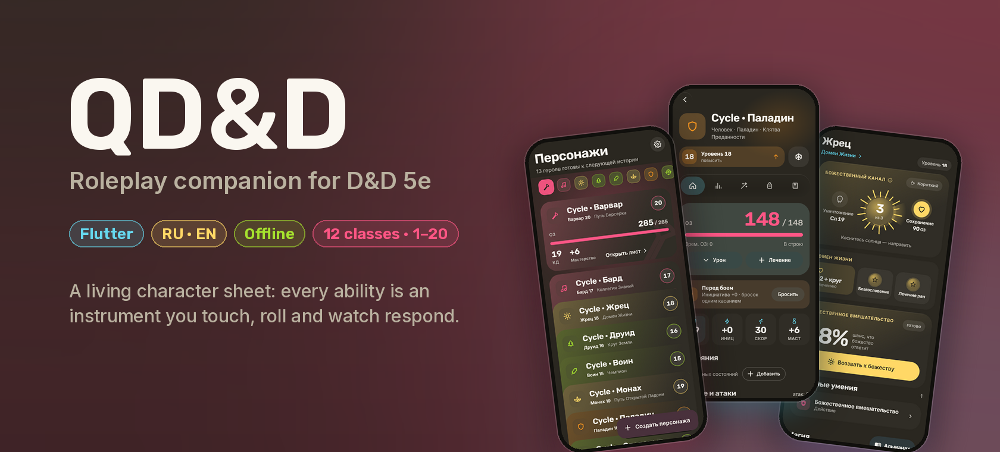

[](README_RU.md)

[](https://flutter.dev)
[](https://github.com/QurieGLord/QDnD-Roleplay-Companion/releases)
[](#)
[](LICENSE)

[Releases](https://github.com/QurieGLord/QDnD-Roleplay-Companion/releases) · [Web version](https://qurieglord.github.io/QDnD-Roleplay-Companion/) · [Report a bug](https://github.com/QurieGLord/QDnD-Roleplay-Companion/issues)

</div>

> [!NOTE]
> **`main` is a development snapshot, not a release.** The code here is far ahead of the published APK and PWA: the whole redesign shown below (waves 0–6), magic and multiclassing, the level-up flow with a class step and rollback, the new character creation, the linked journal, the library shelf and hero transfer all arrived after the last release. Progress and decisions are tracked in [`docs/`](docs/) (in Russian), starting with the [redesign course](docs/REDESIGN_COURSE_2026-10-21.md).

## A sheet that plays back

**QD&D** (the Q is for *Qurie*) is a D&D 5e companion for your phone. It doesn't copy the paper sheet. Every ability is an instrument you touch, and the number you need shows up where you touched it. Dice roll on the spot, counters roll like odometers, and blocks change shape as your hero changes. Everything works offline, in Russian and English.

<table>
<tr>
<td width="46%">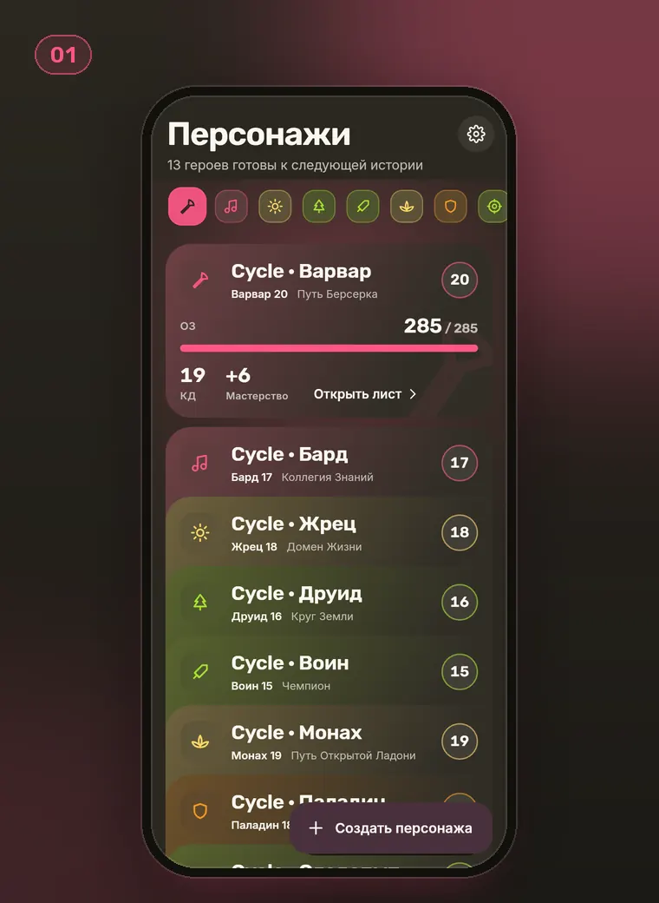</td>
<td>

### 01 · The party, as a deck

The roster is a deck of cards. The card at the focus line opens and the rest tuck behind it. Paging is deliberately viscous: the deck gets heavier at each card, settles on a soft spring, and ticks under your thumb as each hero arrives.

The party line above holds every hero's class sigil. Tap one to fly to that hero. The glow behind the deck takes on the focused hero's colour.

</td>
</tr>
</table>

## Twelve classes, twelve instruments

Every class has its own panel, scaled from level 1 to 20 by the class's own level. Mechanics come from SRD 5.1. Hold any element to read a hint, or tap ⓘ for the full rule.

<table>
<tr>
<td width="50%">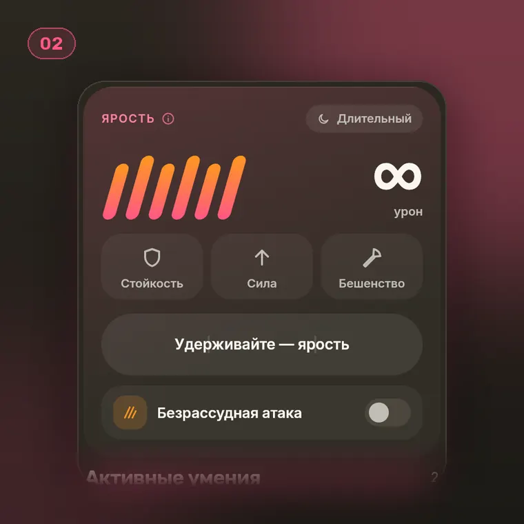<br><b>02 · Barbarian.</b> Hold the bar to break into rage: heat fills it in three beats, then the claws and the round fuse light up.</td>
<td width="50%">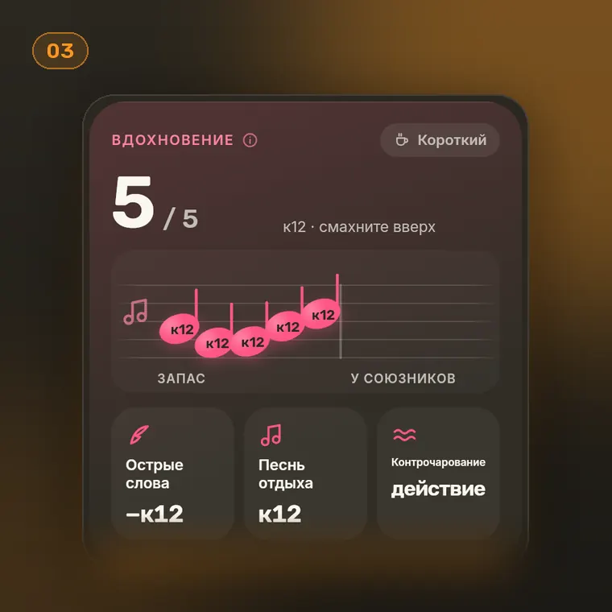<br><b>03 · Bard.</b> Inspiration notes sit on a staff. A note you give hops over the bar line to your allies, and when an ally uses it the die rolls right inside the note.</td>
</tr>
<tr>
<td>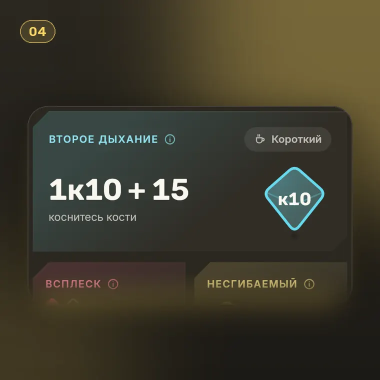<br><b>04 · Fighter.</b> Tap the d10 of Second Wind. It is tossed, lands upright, and the healing rolls straight into your HP.</td>
<td>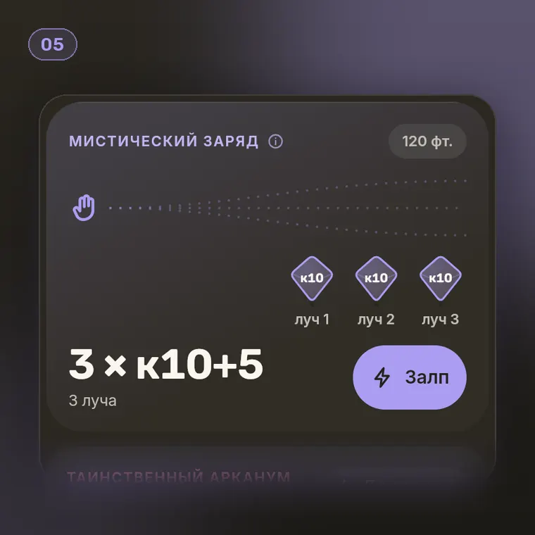<br><b>05 · Warlock.</b> Eldritch Blast fires its beams with a d10 at the end of each. Mark a miss and the total recounts.</td>
</tr>
<tr>
<td>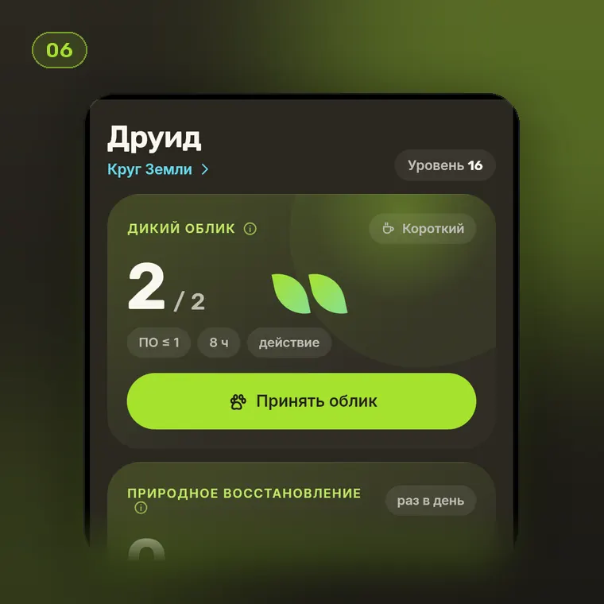<br><b>06 · Druid.</b> The hero turns into the beast as one morphing block. The beast keeps its own HP, and any overflow passes back to the hero.</td>
<td>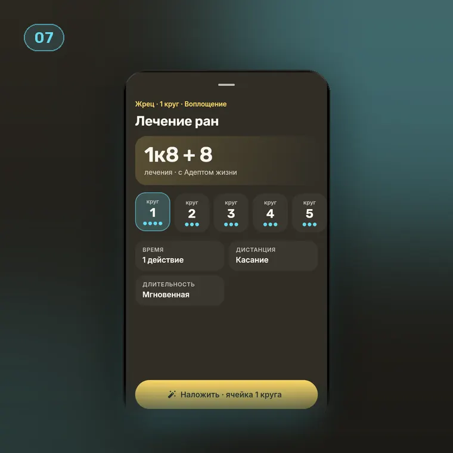<br><b>07 · Casting.</b> The cast sheet knows its spell: pick a higher slot and the effect line changes with it. Save DC and attack appear only when the spell needs them.</td>
</tr>
</table>

Classes from third-party books or your own homebrew are drawn by a **universal kit** built from their data: uses become tokens of the class motif, reserves become bars, dice roll in place, modes count rounds, and passives turn into badges.

## From level 1 to 20

<table>
<tr>
<td width="50%">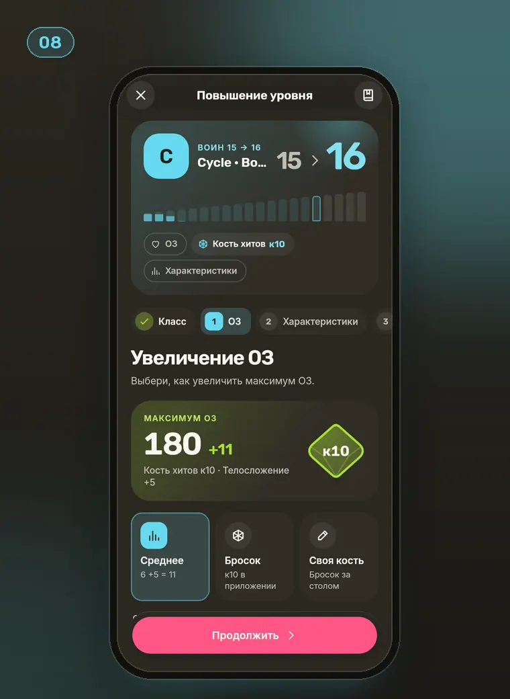<br><b>08 · Level-up.</b> The «Climb» head shows the jump in big numbers over a ladder of twenty rungs. The hero's own levels fill on the way in, and the new rung fills as each step is settled. Steps slide by a whole page, the class comes first as step 0, and every new class says what it needs and what the hero has.</td>
<td width="50%">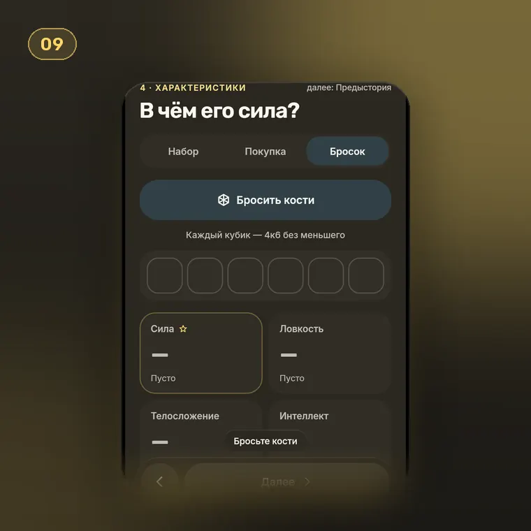<br><b>09 · Creation.</b> «Prologue» builds the hero card as you go. Roll for abilities and six dice rise out of the button, spin down one by one, warm with a soft halo, then their values drift into the tray.</td>
</tr>
<tr>
<td colspan="2">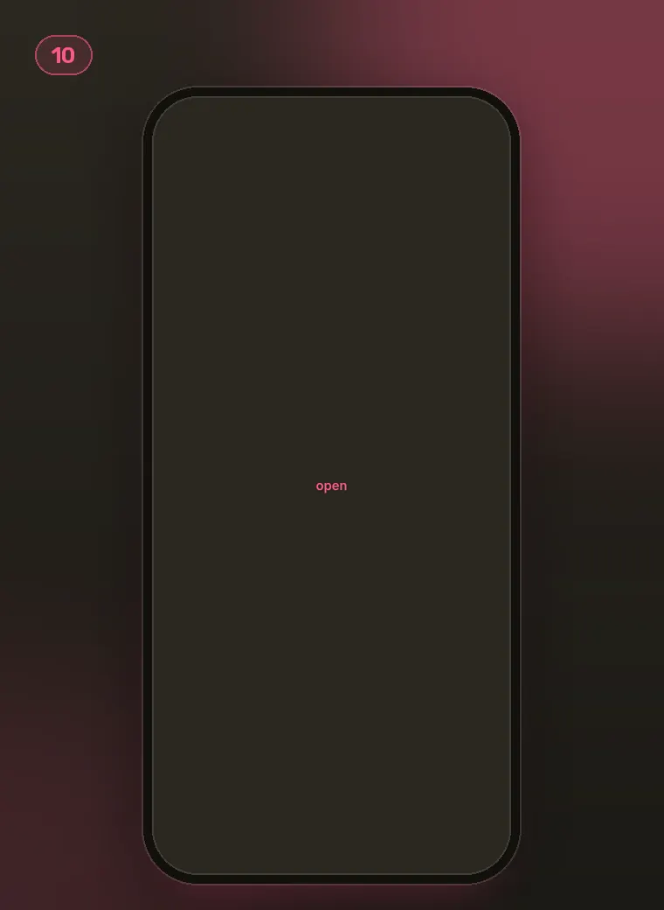<b>10 · History.</b> Every confirmed level-up is a rung. Tap one to see what a rollback would take away, then hold to roll back: the rungs slide off and the hero returns to that level. The journal, belongings and current HP stay.</td>
</tr>
</table>

## What's inside

- **Character sheet:** HP with temporary HP and death saves, conditions, weapons and attacks, abilities, saves and skills.
- **Session and combat:** turns, initiative and class actions on one shared action path, so the sheet and combat always agree and a failed save never leaves half a change.
- **Magic and multiclassing:** shared and Pact slots, preparation by class, rituals, concentration, Mystic Arcanum, Spell Mastery and Signature Spells, plus an almanac of spells.
- **Level-up:** a class step with multiclass prerequisites, hit points, ability score improvements, subclasses, per-class choices and spells, a summary of every change, and an advancement history you can roll back.
- **Character creation:** name, people, class, abilities (standard set, point buy or a roll), background, skills, features and gear, ending on a full sheet preview.
- **Journal:** a pin board, a tape of sessions, manuscript pages, and people, places and quests linked into a living atlas.
- **Content libraries:** a shelf with the built-in SRD 5.1 (2014), which you can switch off but not delete, and your books beside it. Import FC5 (Fight Club 5) XML or ZIP and QDND bundles; when your book overlaps the base one, you choose which wins. The same spell, class or people from several books is one entry with its versions, and a book never rewrites the built-in rules: compendiums that mark 2024 rules (such as «Fireball [5.5e]») are read as found and kept as versions.
- **Hero transfer:** a full `.qdnd` copy with your own content inside, or a sheet as XML.
- **Themes:** Monokai, Gruvbox, Catppuccin and more, in light and dark, with a quieter Basic mode, large text and reduced motion.

## Getting started

**Android:** download the APK from [Releases](https://github.com/QurieGLord/QDnD-Roleplay-Companion/releases); it needs Android 7.0+. Releases still contain the previous build.

**iPhone and iPad:** open the [web version](https://qurieglord.github.io/QDnD-Roleplay-Companion/) in Safari and choose *Share → Add to Home Screen*.

**From source:**

```bash
git clone https://github.com/QurieGLord/QDnD-Roleplay-Companion.git
cd QDnD-Roleplay-Companion
flutter pub get
flutter run
```

## Where it's heading

The redesign campaign took every finished screen to the new design code wave by wave, each time with an interactive prototype first:

| | Wave | |
|:-:|---|:-:|
| 0 | Living components and sheet performance | ✅ |
| 1 | Lobby and hero sheet | ✅ |
| 2 | Magic, class instruments, lobby roster | ✅ |
| 3 | Session and combat | ✅ |
| 4 | Journal | ✅ |
| 5 | Settings and libraries | ✅ |
| 6 | Level-up and character creation | ✅ |

The first part of a shared content model is in: every book entry has a stable identity, creation shows one card per concept with its versions, items remember which version of a book they came from, and a hero brought in from FC5 is matched against your libraries. Next come the inventory, the Forge and quest rewards, and then a stable 1.0. The built-in SRD 5.2 (2024), with a choice of edition, comes in a later release.

## License and credits

The code is under the [MIT License](LICENSE).

The game content includes material from the *System Reference Document 5.1* by Wizards of the Coast LLC, available under [CC BY 4.0](https://creativecommons.org/licenses/by/4.0/). Fonts: [Rubik](assets/fonts/Rubik-OFL.txt) and [Inter](assets/fonts/Inter-OFL.txt), under the SIL Open Font License.

<div align="center">

**Made by [Qurie](https://github.com/QurieGLord)** · *may your d20 land on a natural 20*

</div>
